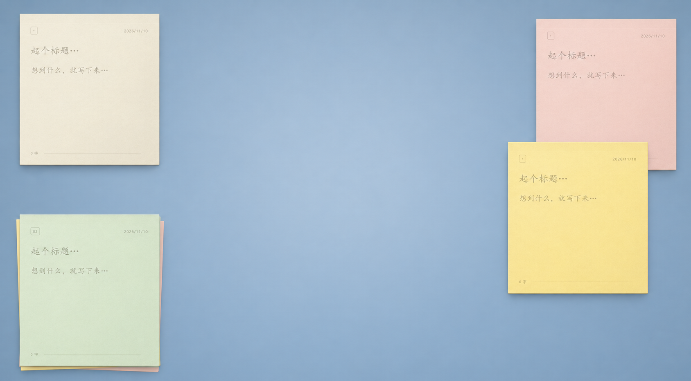

# 便签

就是一张普通的便签，只不过贴在电脑上。

[下载 Windows 版](https://github.com/Neocvsu-commits/bianqian/releases/latest) · v0.31.0 · ZIP 约 5.5 MB · [反馈问题](https://github.com/Neocvsu-commits/bianqian/issues)

便签是一款 Windows 桌面便签工具，用来随手记下想法、临时事项和待办。它保留了纸张的外观和揭起、撕下的操作感，可以把多张便签留在桌面上，也可以把写完的内容收进便签本。内容自动保存在本机，无需注册账号。



## 主要功能

- **桌面便签**：同时保留多张便签，拖动调整位置，也可以将所有便签置顶。
- **撕页与整理**：从纸张两侧揭起，选择归档、删除或撕下来；也可以直接点击对应按钮。撕下当前页后，便签本会补上一张空白页。
- **文字与待办**：支持标题、正文、加粗、下划线、删除线和高亮；将当前行设为待办后，可以点击圆圈标记完成。
- **纸张配色与主题**：提供五种纸色和随机配色，搭配纸张纹理、揭纸动画与可关闭的纸声。深色模式独立切换，纸张、调色板和工具栏统一使用深色外观。
- **历史与恢复**：查看已归档、桌面便签和最近删除的内容，恢复便签，或撤销最近一次归档、删除操作。
- **本地保存与导出**：编辑内容自动保存，可将单张便签或全部未删除的便签导出为文本。

## 下载与安装

1. 打开 [Releases](https://github.com/Neocvsu-commits/bianqian/releases/latest)，下载 Windows x64 的 ZIP 压缩包。
2. 解压到自己选择的文件夹，双击 `便签.exe` 启动，无需安装。
3. 当前版本采用轻量程序包，界面资源内置于 EXE，运行时使用电脑上的 Microsoft Edge WebView2。缺少运行环境时，程序会提示安装；可前往 [微软官方下载页](https://developer.microsoft.com/microsoft-edge/webview2/) 安装 Evergreen Runtime。

更新时先关闭旧版，再解压并运行新版。便签数据保存在用户目录中，更换程序文件夹后仍会读取原有内容。

系统要求为 Windows 10 / 11 x64。Windows 11 已预装 WebView2，大部分更新过的 Windows 10 也已具备该运行环境。首次补装需要联网；便签日常使用和保存内容不需要联网。v0.21.0 及更早的 Release 使用 Electron，下载体积较大。

## 基本使用

- 在纸张上直接输入标题和正文。鼠标移到便签上时，会显示窗口按钮和编辑工具。
- 拖动纸张顶部移动便签，可以跨显示器拖放；点击上方图钉可切换所有便签置顶。
- 左侧从上到下是**归档、删除、撕下来**。撕下后的独立便签保留归档和删除操作。
- 使用揭纸手势时，从左边缘或右边缘向内拖动，移入目标操作区域后松手；按 `Esc` 可取消。
- 点击上方的便签本图标，查看归档、桌面便签与最近删除。在便签详情中可以恢复或导出内容。
- 点击便签本图标右侧的月亮／太阳按钮，在深色与浅色模式之间切换，所有便签窗口同步生效。
- 点击减号隐藏当前便签；在便签本的“桌面便签”列表中可重新打开。便签本窗口的关闭按钮会保存并退出全部便签。

文字格式作用于选中的文字；没有选中文字时，作用于光标所在行。待办按钮始终切换当前行的待办状态。

尚未手动选择主题时，显示模式跟随系统；点击主题按钮后记住手动选择。主题只改变显示外观，不改写便签保存的纸色，切回浅色模式会恢复原来的配色。

## 快捷键

快捷键在便签窗口获得焦点时生效。

| 快捷键 | 操作 |
| --- | --- |
| `Ctrl + N` | 在便签本中撕下当前页；在独立便签中打开便签本 |
| `Ctrl + B` | 加粗 |
| `Ctrl + U` | 下划线 |
| `Ctrl + Shift + X` | 删除线 |
| `Ctrl + Shift + H` | 高亮 |
| `Ctrl + Shift + L` | 切换当前行待办 |
| `Ctrl + Z` | 编辑文字时撤销文字修改；焦点在输入框外时撤销最近一次归档或删除 |
| `Esc` | 取消正在进行的拖动或揭纸操作 |

## 数据保存与备份

便签内容、归档、最近删除和窗口设置保存在 `%APPDATA%\SiyeDemo\notes.json`。可在资源管理器地址栏输入 `%APPDATA%\SiyeDemo` 打开数据目录。

备份时先关闭程序，再复制整个 `SiyeDemo` 文件夹。导出的文本适合阅读和另行整理，不包含纸色、文字格式等完整状态。当前不提供云同步。

## 从源码运行

轻量版使用 Tauri、WebView2、HTML、CSS 和 JavaScript。构建需要 Node.js、Rust 稳定版及 Visual Studio C++ Build Tools；本机还需要 WebView2 Runtime。

```powershell
npm run check
npm run package
```

打包脚本将前端资源复制到 `.work/webview-assets`，编译 Rust 宿主并内嵌资源，产物位于 `release\便签 Demo 31`，同时生成带版本号的 ZIP 和 SHA-256 文件。脚本默认离线构建；首次构建前需要联网获取依赖：

```powershell
cargo fetch --manifest-path native/Cargo.toml
```

`desktop/note-model.js` 是两个宿主共用的便签数据模型；`desktop/backend.js` 协调轻量版多窗口数据与保存，`native` 目录负责 Windows 窗口、显示器坐标和文件操作。旧 Electron 入口保留在 `desktop/main.cjs`，需要时可以使用 Electron 44.7.0 运行源码，或通过 `npm run package:electron` 构建备用版本。

## v0.31.0 更新

本次公开发布包含 v0.21.0 之后完成的轻量化与交互改进。

- **轻量化**：使用系统 WebView2，下载包约 5.5 MB，无需随程序携带整套 Chromium 和 Node.js；沿用原有便签数据目录。
- **深色模式**：通过月亮／太阳按钮切换，纸张、文字、工具栏和归档预览同步调整；五种纸色在深浅模式下分别呈现。
- **拖动与切换**：支持跨显示器移动，修正拖动卡顿、松手回跳与落点偏移；优化桌面便签和便签本之间的画面切换。
- 分开保存便签本窗口尺寸与桌面便签坐标，修正重启后便签本变窄、工具栏和归档区被裁切的问题。
- 自动修复旧版本误存的小便签尺寸，打开时恢复完整的便签本布局，并按屏幕工作区调整位置。
- 桌面操作提示跟随纸张下缘显示，撤销按钮也保留在便签附近。

## v0.21.0 更新

归档、删除、撕下来从底部移到便签左侧，按上、中、下纵向排列；底部保留颜色与文字工具。同步调整了左侧按钮的点击区域和桌面边界留白，避免贴近屏幕左边缘时按钮被裁切。
