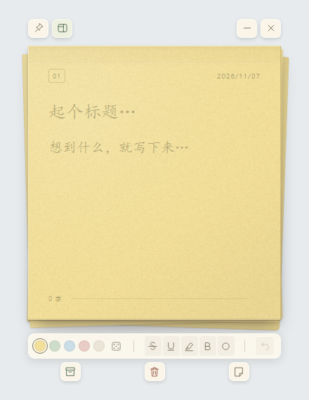

# 便签

就是一张普通的便签，只不过贴在电脑上。

[下载 Windows 版](https://github.com/Neocvsu-commits/bianqian/releases/latest) · v0.21.0 · [反馈问题](https://github.com/Neocvsu-commits/bianqian/issues)

便签是一款 Windows 桌面便签工具，用来随手记下想法、临时事项和待办。它保留了纸张的外观和揭起、撕下的操作感，可以把多张便签留在桌面上，也可以把写完的内容收进便签本。内容自动保存在本机，无需注册账号。



*截图为较早版本；v0.21.0 已将归档、删除、撕下来移至纸张左侧。*

## 主要功能

- **桌面便签**：同时保留多张便签，拖动调整位置，也可以将所有便签置顶。
- **撕页与整理**：从纸张两侧揭起，选择归档、删除或撕下来；也可以直接点击对应按钮。撕下当前页后，便签本会补上一张空白页。
- **文字与待办**：支持标题、正文、加粗、下划线、删除线和高亮；将当前行设为待办后，可以点击圆圈标记完成。
- **纸张配色**：提供五种纸色和随机配色，搭配纸张纹理、揭纸动画与可关闭的纸声。
- **历史与恢复**：查看已归档、桌面便签和最近删除的内容，恢复便签，或撤销最近一次归档、删除操作。
- **本地保存与导出**：编辑内容自动保存，可将单张便签或全部未删除的便签导出为文本。

## 下载与安装

1. 打开 [Releases](https://github.com/Neocvsu-commits/bianqian/releases/latest)，下载 Windows x64 的 ZIP 压缩包。
2. 解压到自己选择的文件夹，双击 `便签.exe` 启动，无需安装。
3. 保留解压后的完整文件夹，程序需要同目录中的运行时文件。

更新时先关闭旧版，再解压并运行新版。便签数据保存在用户目录中，更换程序文件夹后仍会读取原有内容。

## 基本使用

- 在纸张上直接输入标题和正文。鼠标移到便签上时，会显示窗口按钮和编辑工具。
- 拖动纸张顶部移动便签；点击上方图钉可切换所有便签置顶。
- 左侧从上到下是**归档、删除、撕下来**。撕下后的独立便签保留归档和删除操作。
- 使用揭纸手势时，从左边缘或右边缘向内拖动，移入目标操作区域后松手；按 `Esc` 可取消。
- 点击上方的便签本图标，查看归档、桌面便签与最近删除。在便签详情中可以恢复或导出内容。
- 点击减号隐藏当前便签；在便签本的“桌面便签”列表中可重新打开。便签本窗口的关闭按钮会保存并退出全部便签。

文字格式作用于选中的文字；没有选中文字时，作用于光标所在行。待办按钮始终切换当前行的待办状态。

## 快捷键

快捷键在便签窗口获得焦点时生效。

| 快捷键 | 操作 |
| --- | --- |
| `Ctrl + N` | 在便签本中撕下当前页；在独立便签中打开便签本 |
| `Ctrl + B` | 加粗 |
| `Ctrl + U` | 下划线 |
| `Ctrl + Shift + X` | 删除线 |
| `Ctrl + Shift + H` | 高亮 |
| `Ctrl + Shift + L` | 切换当前行待办 |
| `Ctrl + Z` | 编辑文字时撤销文字修改；焦点在输入框外时撤销最近一次归档或删除 |
| `Esc` | 取消正在进行的拖动或揭纸操作 |

## 数据保存与备份

便签内容、归档、最近删除和窗口设置保存在 `%APPDATA%\SiyeDemo\notes.json`。可在资源管理器地址栏输入 `%APPDATA%\SiyeDemo` 打开数据目录。

备份时先关闭程序，再复制整个 `SiyeDemo` 文件夹。导出的文本适合阅读和另行整理，不包含纸色、文字格式等完整状态。当前不提供云同步。

## 从源码运行

项目使用 Electron、HTML、CSS 和 JavaScript。准备好 Node.js 与 npm 后，在项目目录中执行：

```powershell
npm install --no-save electron@44.7.0
npx electron .
```

`npm run check` 可检查 JavaScript 语法。Windows 打包使用项目内安装的 Electron 运行时：

```powershell
powershell.exe -NoProfile -ExecutionPolicy Bypass -File scripts/package.ps1 -RuntimePath .\node_modules\electron\dist
```

产物位于 `release\便签 Demo 21`。发布或分享时需要保留整个目录。

## v0.21.0 更新

归档、删除、撕下来从底部移到便签左侧，按上、中、下纵向排列；底部保留颜色与文字工具。同步调整了左侧按钮的点击区域和桌面边界留白，避免贴近屏幕左边缘时按钮被裁切。
